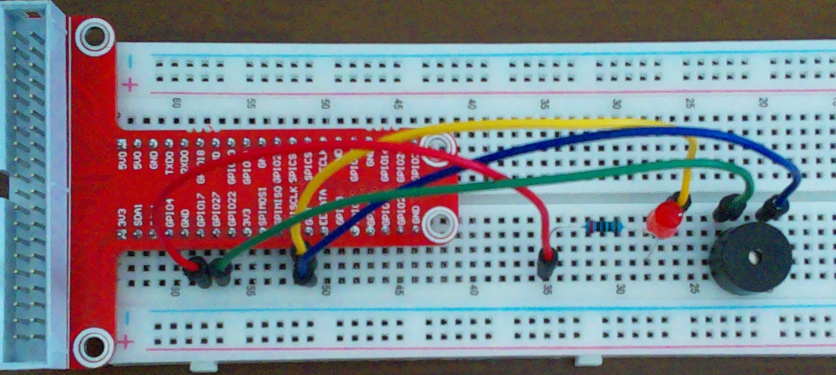
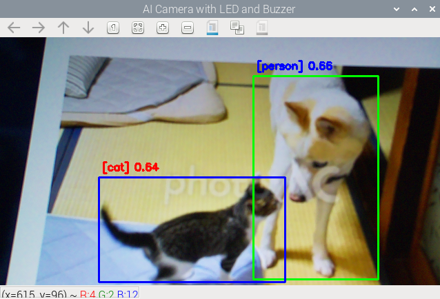
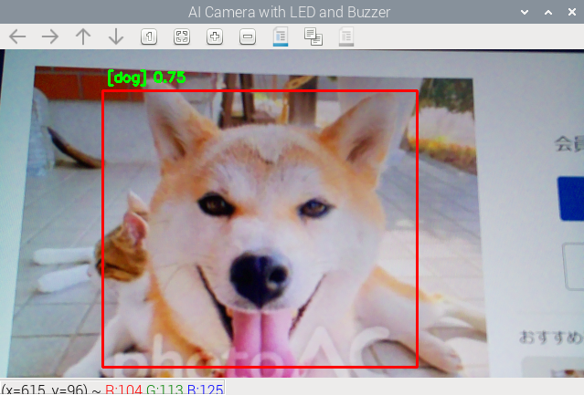

# AIカメラ

Raspberry Pi上で動作するリアルタイム物体検知AIカメラシステムです。

## 概要

TensorFlow Liteを使用した軽量な物体検知システムをRaspberry Pi上で動作させ、カメラ映像から対象物を検出します。

AIモデルによる推論だけでなく、検出結果の可視化やGPIO制御による外部機器連携まで実装しています。

## 主な機能

- TensorFlow Liteによる物体検知
- カメラ映像からリアルタイム推論
- 検出対象のラベル表示
- バウンディングボックス描画
- 検出結果に応じたLEDとブザー制御
- 描画設定の外部ファイル管理

## システム構成

```text
Camera Module
      │
      ▼
  Picamera2
      │
      ▼
TensorFlow Lite
   物体検知
      │
      ├─→ バウンディングボックス描画
      │
      └─→ 検出判定
               │
               ▼
             GPIO
           ├─ LED
           └─ ブザー
```

## 使用ハードウェア

- Raspberry Pi 4 Model B 4GB
- Raspberry Pi Camera Module 2
- OSOYOO Raspberry Pi Starter Kit（LED、圧電ブザー）

## 技術スタック

- OS: Raspberry Pi OS Bookworm 64bit
- 言語: Python 3.11.2
- 推論: TensorFlow Lite
- 画像処理: OpenCV
- カメラ: Picamera2
- 入出力: RPi.GPIO
- テスト: pytest

## 依存パッケージ

### Pythonパッケージ（requirements.txt）

|パッケージ|用途|
|--|--|
|tflite-runtime|TensorFlow Lite推論|

### 開発・テスト用Pythonパッケージ（requirements_dev.txt）

上記に加えて、以下を使用します。

|パッケージ|用途|
|--|--|
|pytest|テストフレームワーク|

### システムパッケージ

|パッケージ|用途|
|--|--|
|picamera2|カメラ制御|
|RPi.GPIO|GPIO制御|
|python3-opencv|画像処理|
|numpy|画像データ処理|

## ディレクトリ構成

```text
ai_camera/
├── tests/
│   ├── test_camera_config.json
│   ├── test_camera_config_collection.py
│   ├── test_draw_config.json
│   ├── test_draw_config_collection.py
│   └── test_rectangle.py
├── ai_camera_buzzer.py
├── camera_config_example.json
├── draw_config.json
├── requirements_dev.txt
└── requirements.txt
```

## セットアップ

```bash
sudo apt install python3-opencv -y
cd ai_camera
python3 -m venv --system-site-packages venv
source venv/bin/activate
pip install -r requirements.txt
```

※ pytestを使用する場合は、`requirements.txt`の代わりに`requirements_dev.txt`をインストールします。

```bash
pip install -r requirements_dev.txt
```

## 物体検出モデルとラベルの準備

本プロジェクトでは、以下の物体検出モデルおよびラベルを使用しました。

モデルファイルおよびラベルファイルは本リポジトリには含めていないため、利用する場合は別途取得し、`camera_config.json`にパスを設定してください。

`camera_config.json`は`camera_config_example.json`をコピーして作成します。

```bash
cp camera_config_example.json camera_config.json
```

`camera_config.json`の`model_path`にモデルファイルのパス、`label_path`にラベルファイルのパスを設定してください。

`camera_config.json`は実行環境毎に異なるため、Gitの管理対象外としています。

### 物体検出モデル

[SSD MobileNet V1（TensorFlow Lite）](https://tfhub.dev/tensorflow/lite-model/ssd_mobilenet_v1/1/metadata/1?lite-format=tflite)

### ラベル

[COCO Labels](https://github.com/raspberrypi/picamera2/blob/wayland-previews/examples/tensorflow/coco_labels.txt)

## 配線



## テスト

```bash
python -m pytest
```

バウンディングボックスの座標変換を担当する`Rectangle`と、カメラおよび描画設定を管理する設定クラスをpytestで検証しています。

設定については正常な読み込みだけでなく、未定義キーを指定した場合の動作も確認しています。

## 実行方法

```bash
python ai_camera_buzzer.py
```

## 実行結果





## 設計方針

Raspberry Pi上でリアルタイム推論を行うため、軽量なTensorFlow Liteモデルを採用しました。

また、物体検出、描画、GPIO制御、カメラ制御をクラス単位で分離し、それぞれの責務を明確にしました。

## 課題と解決方法

### 実行環境によって異なる設定

モデルおよびラベルのパスや検出閾値をソースコードへ直接記述すると、環境や検出条件を変更するたびにコードの修正が必要になります。

そのため、これらをJSONファイルへ外出しし、ソースコードを変更せず設定を変更できる構成としました。

## 今後の改善予定

- 物体検出精度の向上
- Webブラウザからの映像確認
- 検出対象設定の動的変更
